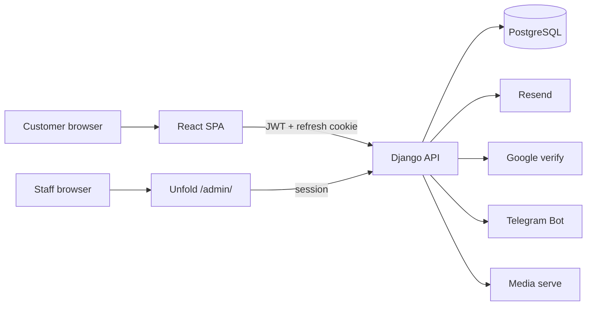

# CGMS — Car Garage Management System  
## Complete Project Document (CarSV)

---

### Cover

| | |
| --- | --- |
| **Institution** | Asia University of Business (AUB) |
| **Year / program** | Year 4 · Semester 1 · CSE |
| **Course** | Project Management |
| **Class** | Prasat Takeo |
| **Group** | Group 7 |
| **Topic** | CGMS — Car Garage Management System (product brand: **CarSV**) |
| **Document type** | Full technical / project report (entire system) |

### Group members

| Name | Responsibility |
| --- | --- |
| **Nam Ayheng** | Leader · Backend (API, Unfold admin logic, auth, Docker/Render, roles, reports) |
| **Ching Chayhour** | Frontend — Customer Website (React public site + portal) |
| **Em Panharith** | Backend — Database (models, migrations, relationships, constraints) |
| **Kim Chantharo** | Frontend — Admin Website (Unfold staff console UX / garage ops UI) |

### Repositories

| Purpose | URL |
| --- | --- |
| Working / development | https://github.com/NamAyheng/carsv-aub.git |
| Teacher submission | https://github.com/tonghengkeo/aub-batch-08-y4-s1-w2-g7-Car-Garage-Management-System.git |

### Environments at a glance

| | **Live (host)** | **Local** |
| --- | --- | --- |
| Git branch | `ayheng` | `ayheng-local` |
| Website | https://carsv-web.onrender.com | http://127.0.0.1:3000 |
| API / Admin | https://carsv-api.onrender.com | http://127.0.0.1:8000 |
| Admin login page | `/admin/login/` | `/admin/login/` |
| Database | Render PostgreSQL | Docker Postgres (`127.0.0.1:5433`) |
| Data shared? | **No** — separate databases | **No** |

**Companion guides:** `ROLE_IN_DASHBOARD.md` · `TERMINAL_RUN.md` · `RENDER.md` · `DOCKER.md` · `Car Garage Management System.md` (assignment text)

---

## Table of contents

1. Introduction and goals  
2. What the product is  
3. Repository layout  
4. Technology stack  
5. Architecture (local + host)  
6. Complete URL map (website, portal, admin, API, media)  
7. Garage service catalog (what customers book)  
8. Users, roles, and how staff are created  
9. Customer website — every page and how it works  
10. Customer portal — every tab and flow  
11. Staff admin — every menu and how ops work  
12. Domain models, statuses, and business rules  
13. Authentication and security (full)  
14. Payments, invoices, parts, notifications  
15. Reports and dashboards  
16. Media and files  
17. Docker Compose and local run  
18. Render hosting  
19. Git history (whole project)  
20. Problems and solutions  
21. Testing  
22. Requirements coverage  
23. End-to-end demo script  
24. Source file map  
25. Limitations and future work  
26. Conclusion and references  

---

## 1. Introduction and goals

This document explains **everything** Group 7 built for **CGMS / CarSV**: not only recent features, but the full garage product — public website, customer portal, Django API, Unfold staff admin, database, auth, Docker, and Render hosting.

### 1.1 Problem

A real garage must track who owns each car, appointments, check-in, inspection, diagnosis, mechanic assignment, parts stock, customer quote approval, invoices, payment proof, and checkout. Paper and chat make that error-prone.

### 1.2 Course goal

Practice software for garage workflows: business logic, data modeling, state machines, validation, authentication, authorization, and UX for Administrator, Manager, Receptionist, Mechanic, Cashier, and Customer (see assignment file `Car Garage Management System.md`).

### 1.3 Product goal

Deliver one coherent system:

- **Customers** self-serve on a React website (book, track, approve quotes, pay).  
- **Staff** operate the workshop in **one** admin console (`/admin/`), with menus filtered by role.  
- **One backend** (Django + Postgres) is the source of truth.

---

## 2. What the product is

**CarSV** (Car Service) is the product name. **CGMS** is the course topic title (Car Garage Management System).

### 2.1 Two surfaces

| Surface | Audience | Tech | Entry |
| --- | --- | --- | --- |
| Public site + customer portal | Customers | React + Vite | Live web URL or `:3000` |
| Staff ERP console | Garage staff | Django Unfold | `/admin/` on API host |

There is **no** separate React app per staff role. Staff share Unfold; `role_access.py` hides modules.

### 2.2 Master visit flow

```
Customer registers / logs in
  → Adds vehicle
  → Books a catalog service (appointment)
  → Staff confirms booking
  → Check-in → Inspection
  → Mechanic assigned → diagnosis / waiting approval
  → Customer confirms quote (or declines)
  → Repairing → Quality check
  → Invoice + payment (customer proof → staff verify)
  → Ready for pickup → Completed
  → Service history (+ optional Telegram alerts along the way)
```

### 2.3 Brand / garage fiction

Used in admin print sheets and marketing tone:

- Brand: **CarSV**  
- Accent: yellow `#ffc400`, dark `#141519`  
- Location copy (examples in templates): St. 271, Phnom Penh  

---

## 3. Repository layout

```
carsv-aub/
├── api-backend/                 # Django project
│   ├── django_backend/          # settings, urls, middleware, wsgi
│   ├── django_app/              # business app (models, admin, APIs, tests)
│   ├── catalog_media/           # public catalog images baked into Docker image
│   ├── media/                   # local private uploads (gitignored)
│   ├── Dockerfile
│   ├── docker-entrypoint.sh     # migrate, collectstatic, optional seed
│   └── requirements.txt
├── web-frontend/                # React customer SPA
│   ├── src/
│   │   ├── App.tsx              # routes
│   │   ├── routes.ts            # path constants
│   │   ├── api/                 # client.ts, garage.ts
│   │   ├── context/AppContext.tsx
│   │   └── components/customer/ # public + portal UI
│   ├── Dockerfile
│   └── package.json
├── mobile-frontend/             # placeholder for later
├── docker-compose.yml           # db + api + web
├── DOCKER.md / RENDER.md / README.md
├── .env.example
└── GUIDELINE & REPORT/          # this document + guides
```

---

## 4. Technology stack (detailed)

| Layer | Technology | Notes |
| --- | --- | --- |
| Customer UI | React 19, TypeScript, Vite 6, Tailwind 4, react-router-dom 7, lucide-react | SPA |
| Staff UI | django-unfold | Custom CSS `carsv-admin.css`, many custom templates |
| Backend | Django 6, DRF, SimpleJWT | App `django_app` |
| DB | PostgreSQL 17 (Compose/Render); SQLite optional without Docker | |
| Auth tokens | Access JWT (~15 min) + HttpOnly refresh cookie `carsv_refresh` | Path `/api/auth/` |
| Customer identity | Email/password + verify; Google GIS ID token; password reset | **Not Auth0** |
| Staff identity | Django session; **username** + password | |
| Email | Resend HTTPS (`email_backends.py`); console locally | SMTP blocked on free Render |
| Telegram | Bot webhook + connect codes; alerts only | Login widget removed from UI |
| Server | Gunicorn + WhiteNoise | |
| Containers | Docker Compose | Ports 3000 / 8000 / 5433 |
| Hosting | Render Static Site + Docker Web Service + Postgres | Branch `ayheng` |

---

## 5. Architecture

### 5.1 Logical



### 5.2 Local Compose

| Container | Image / build | Host port | Role |
| --- | --- | --- | --- |
| `carsv-db` | postgres:17 | `127.0.0.1:5433` → 5432 | Database |
| `carsv-api` | `api-backend/Dockerfile` | `8000` | Gunicorn Django |
| `carsv-web` | `web-frontend/Dockerfile` | `3000` | Vite dev (`npm run dev`) |

Vite proxies `/api` and `/media` to `http://api:8000` via `VITE_PROXY_TARGET`.  
API bind-mounts `./api-backend` so media on disk is visible.  
**After backend code changes:** `docker compose restart api`.

### 5.3 Live Render

| Service | Root | Notes |
| --- | --- | --- |
| Static Site | `web-frontend` | `npm ci && npm run build` → `dist`; `VITE_API_URL` = API HTTPS URL; SPA rewrite `/*` → `/index.html` |
| Web Service | `api-backend` | Docker; `$PORT`; migrate on start |
| Postgres | managed | `DATABASE_URL` |

Cross-site cookies: `DJANGO_COOKIE_SECURE=1`, `DJANGO_REFRESH_COOKIE_SAMESITE=None`, CORS/CSRF/`FRONTEND_URL` must match the Static Site origin.

---

## 6. Complete URL map

Base examples:  
- Live web = `https://carsv-web.onrender.com`  
- Live API = `https://carsv-api.onrender.com`  
- Local web = `http://127.0.0.1:3000`  
- Local API = `http://127.0.0.1:8000`

### 6.1 Public website routes (`web-frontend/src/App.tsx` + `routes.ts`)

| Path | Purpose |
| --- | --- |
| `/` | Home / marketing landing |
| `/about` | About section |
| `/services` | Services catalog section |
| `/how-it-works` | How it works |
| `/live-bay` | “Live bay” / transparency section (no real CCTV) |
| `/blog` | Blog list (from API) |
| `/contact` | Contact |
| `/verify-email` | Email verification page (`?token=`) |
| `/reset-password` | Password reset confirm (`?token=`) |

Query helpers: `/?signin=1&next=/dashboard`, legacy `/?reset=1&token=…` redirects to `/reset-password`.

### 6.2 Customer portal routes (require role `CUSTOMER`)

| Path | Tab | Screen |
| --- | --- | --- |
| `/dashboard` | Dashboard | Overview KPIs / cards |
| `/vehicles` | Vehicles | Own vehicles CRUD |
| `/appointments` | Appointments | Bookings list + book modal |
| `/tracking` | Tracking | Work-order progress |
| `/quotes` | Quotes | Approve / decline repair quote |
| `/parts` | Parts | Parts catalog + part requests |
| `/invoices` | Invoices | Bills + payment claims |
| `/documents` | Documents | Assembled docs / PDF helpers |
| `/reviews` | Reviews | Feedback UI (storage limited) |
| `/profile` | Profile | Account, Google link, Telegram connect |

Unknown paths → redirect `/`.

### 6.3 Staff admin paths (API host)

| Path | Purpose |
| --- | --- |
| `/admin/login/` | Staff login (username + password) |
| `/admin/` | Role dashboard |
| `/admin/django_app/customer/` | Customers |
| `/admin/django_app/vehicle/` | Vehicles |
| `/admin/django_app/booking/` | Bookings |
| `/admin/django_app/service/` | Service catalog |
| `/admin/django_app/servicecategory/` | Service categories |
| `/admin/django_app/blogpost/` | Blog |
| `/admin/django_app/repairjob/` | Work orders |
| `/admin/django_app/inspection/` | Inspections |
| `/admin/django_app/mechanic/` | Technicians |
| `/admin/django_app/staff/` | Staff profiles |
| `/admin/django_app/sparepart/` | Parts inventory |
| `/admin/django_app/sparepartcategory/` | Part categories |
| `/admin/django_app/partsusage/` | Parts usage |
| `/admin/django_app/partrequest/` | Part requests |
| `/admin/django_app/invoice/` | Invoices |
| `/admin/django_app/payment/` | Payments |
| `/admin/django_app/garagereport/` | Reports |
| `/admin/garage-reports/` | Alias → Reports |
| `/admin/django_app/role/` | Roles |
| `/admin/django_app/user/` | Users |
| `/admin/auth/group/` | Redirect → Roles |

### 6.4 Auth API

| Method | Path | Purpose |
| --- | --- | --- |
| POST | `/api/auth/register/` | Customer register |
| POST | `/api/auth/login/` | Email/username + password |
| POST | `/api/login/` | Alias of login |
| POST | `/api/auth/logout/` | Logout / blacklist refresh |
| POST | `/api/auth/token/refresh/` | Refresh access JWT |
| GET/PATCH | `/api/auth/me/` | Current user profile |
| GET | `/api/auth/public-config/` | Public auth config (e.g. Google client id) |
| POST | `/api/auth/google/` | Google GIS ID token login |
| POST | `/api/auth/telegram/` | Telegram login API (UI removed) |
| POST | `/api/auth/link/google/` | Link Google |
| POST | `/api/auth/link/telegram/` | Link Telegram |
| POST | `/api/auth/telegram/connect/` | Start Telegram connect |
| POST | `/api/telegram/webhook/` | Telegram webhook |
| POST | `/api/auth/unlink/` | Unlink provider |
| POST | `/api/auth/verify-email/` | Verify email token |
| POST | `/api/auth/resend-verification/` | Resend verify mail |
| POST | `/api/auth/password-reset/` | Request reset email |
| POST | `/api/auth/password-reset/confirm/` | Confirm new password |
| POST | `/api/auth/password/change/` | Change password (logged in) |

### 6.5 Public catalog API

| Path | Purpose |
| --- | --- |
| GET `/api/public/services/` | Active services for marketing/booking |
| GET `/api/public/blog/` | Blog posts |

### 6.6 Customer API (DRF router under `/api/customer/`)

Standard list/create/retrieve/update/delete where allowed, plus actions:

| Resource | Extra actions (examples) |
| --- | --- |
| `/api/customer/vehicles/` | CRUD own vehicles |
| `/api/customer/bookings/` | `cancel/`, `reschedule/`, `add-service/`, `remove-service/` |
| `/api/customer/repairs/` | `confirm/`, `decline/` (quote) |
| `/api/customer/inspections/` | Read |
| `/api/customer/services/` | Catalog for portal |
| `/api/customer/invoices/` | Read |
| `/api/customer/payments/` | Create claim; `withdraw/` |
| `/api/customer/parts/` | Catalog |
| `/api/customer/part-requests/` | Create; `withdraw/`; `confirm-purchase/` |
| `/api/customer/history/` | Completed history |
| `/api/customer/estimates/` | `approve/`, `reject/` |
| `/api/customer/notifications/` | Mark read; `read-all/` |

### 6.7 Staff REST API (`/api/` — administrator-oriented)

ViewSets: `users`, `customers`, `vehicles`, `service-categories`, `services`, `bookings`, `staff`, `inspections`, `mechanics`, `repair-jobs`, `spare-part-categories`, `spare-parts`, `parts-usages`, `invoices`, `payments`.

Permission: typically `IsGarageAdmin` (admin/superuser). Day-to-day staff work is Unfold admin, not these ViewSets.

### 6.8 Media

| Path | Purpose |
| --- | --- |
| GET `/media/<path>` | Catalog (public prefixes) or private with signed `?m=` |

---

## 7. Garage service catalog (what we offer)

Services are rows in `Service` + `ServiceCategory`. Public site and booking modal load them from `/api/public/services/` (and portal `/api/customer/services/`).

### 7.1 Categories (catalog seed)

Brake · Engine · Maintenance · Tires · AC · Electrical · Transmission

### 7.2 Example services (`seed_catalog_demo`)

| Service | Category | Price (USD) | Duration |
| --- | --- | --- | --- |
| Oil change | Maintenance | 35.00 | 45 min |
| General inspection | Maintenance | 25.00 | 60 min |
| Wheel alignment | Tires | 45.00 | 60 min |
| AC recharge | AC | 70.00 | 75 min |
| Brake fluid flush | Brake | 40.00 | 50 min |
| Spark plug replacement | Engine | 55.00 | 60 min |
| Cabin filter replacement | Maintenance | 20.00 | 30 min |
| Battery replacement | Electrical | 95.00 | 40 min |
| Transmission service | Transmission | 120.00 | 90 min |
| Coolant flush | Engine | 48.00 | 50 min |
| Brake repair | Brake | 80.00 | 90 min |

Local `seed_users` also creates simpler demos (e.g. Brake pad replacement, Oil change, General inspection) plus sample vehicles/bookings.

### 7.3 How booking a service works

1. Customer opens Book modal (from services or Appointments).  
2. Selects **vehicle** + **service** (+ date/time, problem text).  
3. POST `/api/customer/bookings/` → status `PENDING`.  
4. Staff opens **Bookings** in admin → confirm.  
5. Later check-in creates/advances **work order** + inspection + invoice helpers.  
6. Extra services on a visit: `add-service` / `remove-service` on the booking.

Spare parts are a separate catalog (`SparePart`) for shop stock and customer **part requests** (install / pickup / delivery).

---

## 8. Users, roles, and staff onboarding

### 8.1 Role codes (`User.Role`)

`ADMIN` · `MANAGER` · `RECEPTIONIST` · `MECHANIC` · `CASHIER` · `CUSTOMER`

Also a `Role` table (name, code, flags like in_staff / in_customers / in_technicians) used when assigning profiles.

### 8.2 Who uses what

| Role | App | How account is created |
| --- | --- | --- |
| Customer | Website | Self-register or Google |
| All staff | `/admin/` | Administrator creates user + role + password + `is_staff` |

Customers **cannot** open admin. Staff **do not** public-register.

### 8.3 Role → admin modules (`role_access.py`)

| Module | Admin | Manager | Receptionist | Mechanic | Cashier |
| --- | --- | --- | --- | --- | --- |
| Dashboard | ✓ | ✓ | ✓ | ✓ | ✓ |
| Customers / vehicles / bookings / services | ✓ | ✓ | ✓ | | |
| Blog | ✓ | ✓ | | | |
| Work orders / inspections | ✓ | ✓ | ✓ | ✓ | |
| Technicians / staff | ✓ | ✓ | | | |
| Parts / usage / requests | ✓ | ✓ | | ✓ | |
| Part categories | ✓ | ✓ | | | |
| Invoices | ✓ | ✓ | ✓ | | ✓ |
| Payments | ✓ | ✓ | | | ✓ |
| Reports | ✓ | ✓ | | | |
| Users / roles | ✓ | | | | |

Mechanics’ work-order list is filtered to **jobs assigned to them**.

Live demo accounts: see `ROLE_IN_DASHBOARD.md`.

---

## 9. Customer website — pages and behavior

### 9.1 Shell

`CustomerPublicShell` — header, nav, theme toggle, sign-in/register, mobile menu. Brand header class `portal-brand-header`.

### 9.2 Landing

`CustomerPublicLanding` — hero, services from public API, CTAs to book/sign-in, trust/hours/contact style sections. Section IDs align with routes (`about`, `services`, `how-it-works`, `transparency` for live-bay, `contact`).

### 9.3 Blog

`CustomerPublicBlog` — loads `/api/public/blog/`.

### 9.4 Auth modal

`CustomerAuthModal` — login, register, forgot password, Google button (GIS). Telegram login was removed from this UI.

### 9.5 Verify email / reset password

Standalone pages call verify and password-reset-confirm APIs with token from query string.

---

## 10. Customer portal — every tab

Implemented in `CustomerPortalApp` + view components; data via `api/garage.ts`.

| Tab | Component (typical) | What the customer does |
| --- | --- | --- |
| Dashboard | `CustomerDashboardHome` | See counts/status summaries |
| Vehicles | `CustomerVehiclesView` | Add/edit/delete cars (unique plate) |
| Appointments | `CustomerAppointmentsView` + book modal | List bookings; book; cancel/reschedule |
| Tracking | `CustomerWorkOrderTracking` | Follow WO status / progress % |
| Quotes | `CustomerQuotesView` | Confirm or decline repair quote |
| Parts | `CustomerProductsView` | Browse parts; request part |
| Invoices | `CustomerInvoicesView` | See invoice; submit payment + proof |
| Documents | `CustomerDocumentsView` | Document/PDF helpers |
| Reviews | `CustomerFeedbackView` | Feedback UI |
| Profile | `CustomerProfileView` | Phone, photo, Google, Telegram connect |

State: `AppContext` (auth, theme, toasts, portal reload).

---

## 11. Staff admin — menus and how operations work

### 11.1 Dashboard

Unfold index with `dashboard_callback` → `carsv_dashboard.html`. Shows name, **email**, role desk label, KPI cards and panels that depend on role (bookings, jobs, revenue, low stock, reports link, mechanic “my jobs”, cashier CTAs, etc.).

### 11.2 Front desk

- **Customers** — register walk-ins, contact info, photos.  
- **Vehicles** — plate, brand/model/year, mileage, in-shop status, images.  
- **Bookings** — confirm, cancel, check-in actions (custom appointment UI).  
- **Service catalog / categories** — prices, duration, images.  
- **Blog** — marketing posts.

### 11.3 Workshop

- **Work orders** — assign mechanic, advance status (gated), progress auto from status.  
- **Inspections** — mileage, fuel, brake/tire mm, condition, damage, photos.  
- **Technicians** — skills, availability.  
- **Staff** — office profiles linked to users.

### 11.4 Stock & billing

- **Parts inventory** — SKU, qty, min stock, price, images; low-stock badges.  
- **Parts usage** — deduct stock onto a WO; sync invoice parts cost.  
- **Part requests** — customer requests; staff confirm/cancel pipeline.  
- **Invoices** — labor/service/parts/discount/tax; printable `iv-sheet`.  
- **Payments** — method, amount, proof image, received_by, verify/reject.  
- **Reports** — date range + type; KPIs; tables; Print/PDF via same sheet style as invoices.

### 11.5 Accounts

- **Roles** — codes and profile flags.  
- **Users** — create staff/customers, set password, role, staff flag.

### 11.6 Custom admin templates (examples)

`garage_reports.html`, `invoice_change_form.html`, `workorder_change_list.html`, `appointment_change_list.html`, `vehicle_*`, `customer_*`, `booking_*`, `sparepart_change_form.html`, `carsv_page.html`, modal forms, delete confirmations.

Styling: `static/django_app/carsv-admin.css` (large CarSV theme + print rules).

---

## 12. Domain models, statuses, and rules

Primary file: `api-backend/django_app/models.py`.

### 12.1 Vehicle statuses

`ACTIVE` · `IN_SHOP` · `INACTIVE`

### 12.2 Booking statuses

`PENDING` → `CONFIRMED` → workshop-aligned statuses (`WAITING`, `DIAGNOSING`, `WAITING_APPROVAL`, `REPAIRING`, `QUALITY_CHECK`, `READY_FOR_PICKUP`) → `COMPLETED` / `CANCELLED`  
(Legacy labels `CHECKED_IN`, `IN_SERVICE` still exist in choices.)

### 12.3 Repair job (work order) statuses

`WAITING` · `DIAGNOSING` · `WAITING_APPROVAL` · `REPAIRING` · `QUALITY_CHECK` · `READY_FOR_PICKUP` · `COMPLETED` · `CANCELLED`

On save: progress % derived from status; diagnosing ensures inspection; waiting approval ensures visit invoice; booking status synced from job.

### 12.4 Inspection

Statuses: `PENDING` · `CHECK_IN` · `COMPLETED`  
Fuel levels 0–100%; measurements; images via `InspectionImage`.

### 12.5 Invoice

Statuses: `DRAFT` · `UNPAID` · `PARTIAL` · `PAID` · `CANCELLED`  
`grand_total = labor + service + parts - discount + tax`.

### 12.6 Payment

Methods: `CASH` · `BANK` · `CARD` · `QR`  
Statuses: `PENDING` · `PAID` · `FAILED` · `REFUNDED`  
Verify requires proof + received_by; amount must match remaining balance.

### 12.7 Part request

Fulfillment: workshop install · counter pickup · delivery  
Statuses: `PENDING` · `NOTED` · `CONFIRMED` · `CANCELLED`

### 12.8 Estimate

`SENT` · `APPROVED` · `REJECTED` (parallel quotation track; visit quote also uses repair confirm/decline).

### 12.9 Other models

`User`, `Role`, `Customer`, `Staff`, `Mechanic`, `AuthProvider`, `BookingService`, `PartsUsage`, `Notification`, `BlogPost`, `GarageReport` (virtual menu model), Telegram link helpers.

### 12.10 Important rules (examples)

- Unique customer/user email; unique vehicle plate (VIN unique if set).  
- Cannot oversell parts stock (`PartsUsage.clean` / save).  
- Stage advances blocked until inspection complete, mechanic assigned, blocking part requests cleared, payment verified where required (`job_advance_block_reason` family).  
- Role assignment syncs Customer / Staff / Mechanic profile rows (`apply_role_assignment`).

---

## 13. Authentication and security (full)

### 13.1 Customer

1. **Register** → inactive/unverified until email link.  
2. **Verify** `/verify-email?token=` → can login.  
3. **Login** email or username + password → JWT + refresh cookie.  
4. **Google** → verify ID token with `GOOGLE_CLIENT_ID`; create/link user.  
5. **Google-only** users must **set password** via reset before password login works.  
6. **Forgot password** → email link → `/reset-password?token=`.  
7. **Telegram** → profile connect + phone share with bot → alerts only.

### 13.2 Staff

1. Admin creates user with staff role.  
2. Login at `/admin/login/` with **username** (not email) + password.  
3. Session cookie; Unfold UI; module permissions from `RoleGatedAdminMixin`.  
4. `AdminSite.has_permission` requires staff role via `can_use_admin`.

### 13.3 Why not Auth0

Public customers already have email verify + Google. Staff are few and admin-provisioned. Auth0 would add cost/complexity without fitting the private ERP model. Some old notes mentioned Auth0; **code uses Google GIS**.

### 13.4 Other security

CORS allowlist middleware; CSRF trusted origins; signed media for private files; refresh token rotation/blacklist; Resend over HTTPS.

---

## 14. Payments, invoices, parts, notifications

### 14.1 Invoice lifecycle

Created/ensured when visit reaches quote stage; costs synced from services + parts usage; status refreshed from verified payments.

### 14.2 Customer payment claim

Customer submits amount/method/proof → `PENDING` → staff **Verify** or reject in Payments admin → invoice may become `PAID` → job can move to ready for pickup.

### 14.3 Parts

- Staff consume parts on WO (`PartsUsage`) → stock down → invoice parts_cost up.  
- Customer `PartRequest` for shelf parts; staff confirm may create usage / open job depending on rules.

### 14.4 Notifications

`Notification` rows in portal; Telegram messages when chat id linked and phone matched. Events include booking/repair/payment style alerts (implemented in bot/services).

---

## 15. Reports and dashboards

### 15.1 Role dashboards

KPI cards differ: receptionist sees today’s bookings; mechanic sees my jobs; cashier sees pending pay / revenue; manager/admin see revenue, stock, reports entry, etc.

### 15.2 Garage reports

Path: Stock & billing → Reports (`GarageReportAdmin` → `reports.py` + `garage_reports.html`).  
Filters: from/to date, type (summary / bookings / repairs / payments / revenue).  
Print: off-screen `iv-sheet` / CarSV brand → browser Print / PDF.  
Allowed: Administrator + Manager.

---

## 16. Media and files

| Kind | Storage | Access |
| --- | --- | --- |
| Service/part/blog catalog | `catalog_media` baked into API image + MEDIA | Public prefixes |
| Vehicle / inspection / payment proof / user photo | `media/` uploads | Signed URL or staff/DEBUG |
| Local Compose | Host folder via bind mount | Survives container recreate |
| Render free disk | Ephemeral | Private uploads can vanish on sleep/redeploy |

---

## 17. Docker Compose and local run

```bash
cp .env.example .env
docker compose up --build
```

| URL | Use |
| --- | --- |
| http://127.0.0.1:3000 | Customer website |
| http://127.0.0.1:8000/admin/ | Staff admin |
| http://127.0.0.1:8000/api/ | API |

Optional without Docker: venv + `runserver` + `npm run dev` (`TERMINAL_RUN.md`).

Seed: `python manage.py seed_users` / `seed_catalog_demo`.

---

## 18. Render hosting

1. Push `ayheng`.  
2. Postgres + Docker API + Static Site.  
3. Env: secrets, CORS/CSRF/FRONTEND_URL, Resend, Google, cookie flags.  
4. Optional `DJANGO_SUPERUSER_*` then remove; optional `DJANGO_SEED_DEMO=1` once.  
5. Google OAuth JS origins include live web URL.  
6. Expect cold start ~1 minute on free tier.

Details: `RENDER.md`.

---

## 19. Git history (whole project)

Remote: https://github.com/NamAyheng/carsv-aub.git  

| Date | Commit | What happened |
| --- | --- | --- |
| Early | `1f9cda7`…`ff6be66` | Init (`rith`/`ro` history) |
| 2026-09-10 | `cb85f30` | Admin/Customer frontend era (`main`) |
| 2026-09-18 | `2fa89ab` | Django models, Unfold admin, seed, admin CSS |
| 2026-09-26 | `4287f68` | Inventory, media uploads, images |
| 2026-10-13 | `8a16d6e` / `d4f1db7` | Merge frontend & backend |
| 2026-10-18 | `290fed6` | Google & Telegram, payment proof, bot, more models |
| 2026-10-23 | `60626f8` | Render/Docker docs, catalog assets |
| 2026-10-23 | `1622980`…`bbf3bc5` | Hosting/auth hardening (media, Resend, Google password, Telegram alerts-only, phone prompt, register soft-fail email) |
| 2026-10-23 | `58e7ec5` | Yellow admin theme |
| 2026-10-23 | `62bab6e` | `ayheng-local`: roles, reports, reset page |
| 2026-10-23 | `239a77b` | Ship to live `ayheng` (header UI kept as live) |

---

## 20. Problems and solutions

| Problem | Fix |
| --- | --- |
| Split FE/BE eras | Merge into one repo product |
| Postgres 5432 busy | Compose host port **5433** |
| Media hidden by empty volume | Bind-mount whole `api-backend` |
| Render catalog 404 | Bake `catalog_media` into image + seed |
| Google-only cannot password login | Reset / set-password path |
| Telegram login confusion / 500s | Alerts only; webhook fixes |
| Missing phone for alerts | Post-login phone prompt |
| Resend sandbox | Allowlisted test inbox; soft register |
| Admin “down” on Render | Cold start wait |
| Custom admin 404 locally | `docker compose restart api` |
| Staff login with email | Use **username** |
| Local vs live passwords | Separate DBs |
| Docs said Auth0 | Use Google GIS in reality |
| Some CustomerApiTests fail | Gates stricter than old tests — follow-up |

---

## 21. Testing

- `api-backend/django_app/tests.py` — auth, admin security, customer API, Telegram helpers.  
- Frontend: `tsc` / lint; no large unit suite.  
- No GitHub Actions CI in repo.  
- Manual smoke: register → verify → book → admin check-in → quote → pay → complete.

---

## 22. Requirements coverage (overview)

Assignment themes vs CarSV:

| Theme | Status |
| --- | --- |
| Login/logout/profile | Done (customer + staff) |
| Roles/permissions | Done via role-gated admin; staff REST still admin-centric |
| Dashboard/KPI | Done per role |
| Customer/vehicle/booking | Done |
| Check-in/inspection/WO/mechanic | Done in admin + tracking |
| Parts/stock | Done |
| Estimate/approve | Done (repair confirm + Estimate model) |
| Invoice/payment/checkout | Done |
| History/notifications | Done (+ Telegram) |
| Reports | Done (Admin/Manager) |
| Maintenance automation | Partial (fields) |
| CCTV / mobile | Not real / not shipped |

---

## 23. End-to-end demo script

**Prep:** Open live API once (wake). Use `ROLE_IN_DASHBOARD.md` for staff usernames.

1. **Customer (website):** register or login → Profile phone → optional Telegram → Vehicles → book Oil change / Brake repair.  
2. **Receptionist:** Bookings → Confirm → Check-in.  
3. **Receptionist/Mechanic:** Complete inspection; assign mechanic.  
4. **Customer:** Quotes → Confirm.  
5. **Mechanic:** Work order progress; add parts usage if needed.  
6. **Customer:** Invoices → submit QR/cash proof.  
7. **Cashier:** Payments → Verify.  
8. **Staff:** Advance to Ready / Complete.  
9. **Manager:** Reports → filter → Print/PDF.  
10. **Admin:** Users/Roles only if showing full control.

---

## 24. Source file map (important paths)

| Path | Role |
| --- | --- |
| `api-backend/django_app/models.py` | Domain + workflow helpers |
| `api-backend/django_app/admin.py` | Unfold ModelAdmins / actions |
| `api-backend/django_app/customer_api.py` | Customer DRF API |
| `api-backend/django_app/auth_api.py` / `auth_services.py` | Auth |
| `api-backend/django_app/role_access.py` | Staff module permissions |
| `api-backend/django_app/dashboard.py` | Admin KPIs / badges |
| `api-backend/django_app/reports.py` | Garage reports |
| `api-backend/django_app/telegram_bot.py` | Telegram alerts |
| `api-backend/django_app/media_serving.py` | Media ACL |
| `api-backend/django_backend/urls.py` | All HTTP routes |
| `api-backend/django_backend/settings.py` | UNFOLD sidebar, JWT, DB |
| `web-frontend/src/App.tsx` | SPA routes |
| `web-frontend/src/routes.ts` | Path constants |
| `web-frontend/src/api/client.ts` | HTTP + refresh |
| `web-frontend/src/api/garage.ts` | Portal data loaders |
| `web-frontend/src/components/customer/*` | All customer UI |
| `docker-compose.yml` | Local stack |

---

## 25. Limitations and future work

- No dedicated React staff apps (Unfold by design).  
- Live bay / CCTV not real cameras.  
- Reviews storage incomplete.  
- Maintenance reminder automation incomplete.  
- Mobile app not built.  
- Free Render: sleep, ephemeral uploads, DB expiry, Resend sandbox.  
- Align remaining failing customer tests with gates.  
- Keep documentation wording on **Google GIS**, not Auth0.

---

## 26. Conclusion

Group 7’s **CGMS / CarSV** is a full-stack garage system: catalog services customers can book, a complete portal for tracking and payment, and a role-aware staff admin for the workshop and cash desk — backed by Django, PostgreSQL, Docker, and Render. This document maps the **entire** product: routes, APIs, models, flows, environments, history, and operations.

---

## References

1. Assignment: `Car Garage Management System.md`  
2. Live staff: `ROLE_IN_DASHBOARD.md`  
3. Local: `TERMINAL_RUN.md`, `DOCKER.md`  
4. Host: `RENDER.md`, `.env.example`  
5. Code trees listed in §24  
6. GitHub working: https://github.com/NamAyheng/carsv-aub.git  
7. GitHub submission: https://github.com/tonghengkeo/aub-batch-08-y4-s1-w2-g7-Car-Garage-Management-System.git  

---

*End of complete project document.*
