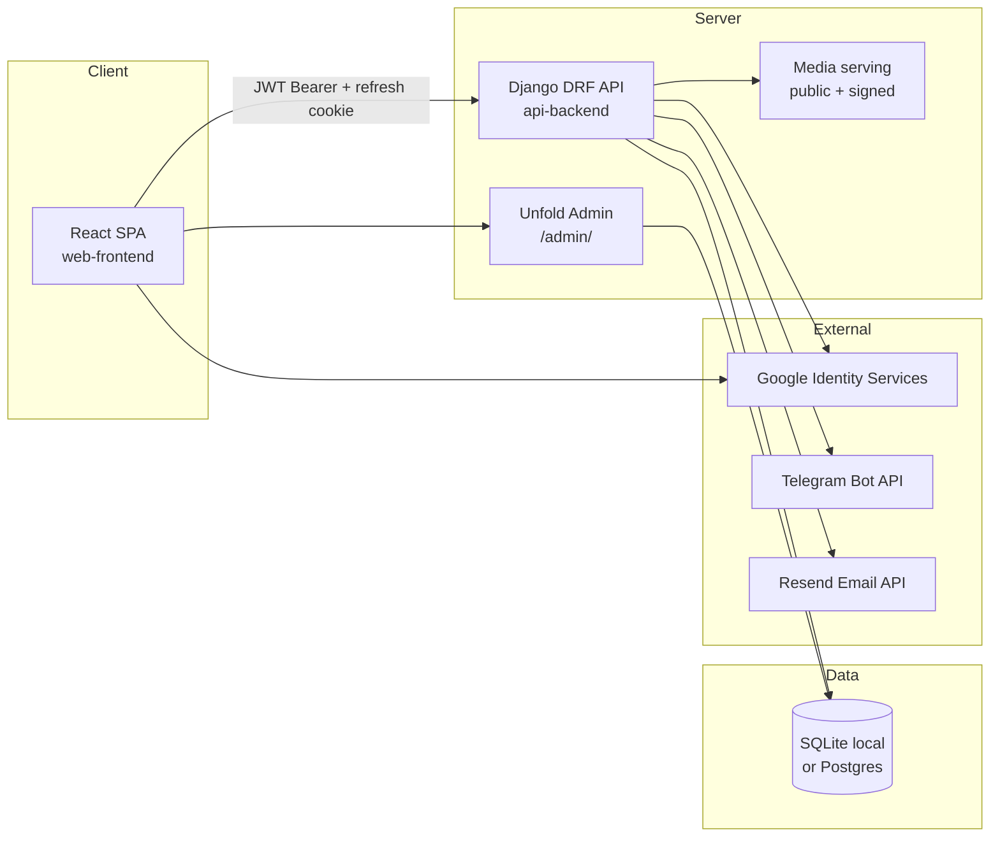
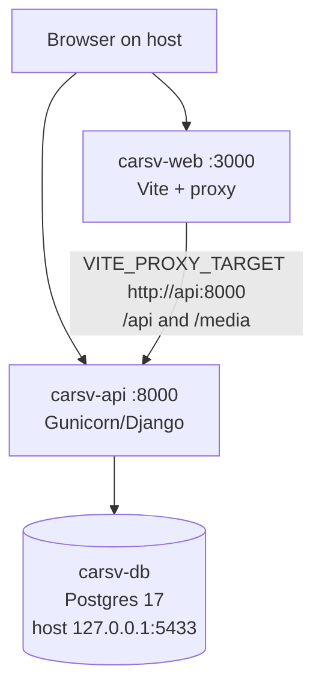
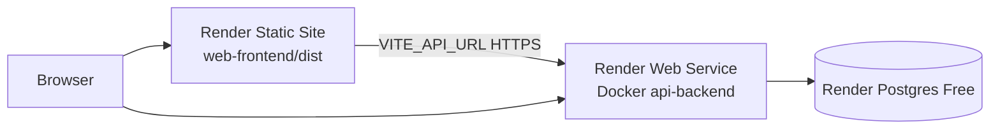
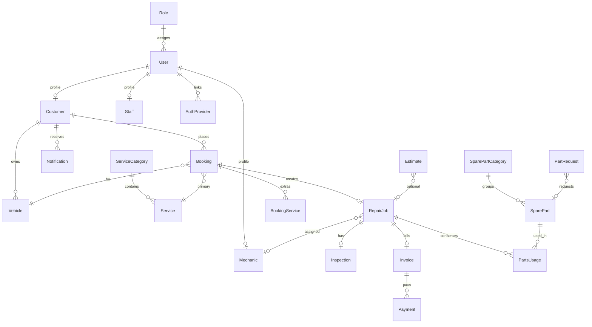
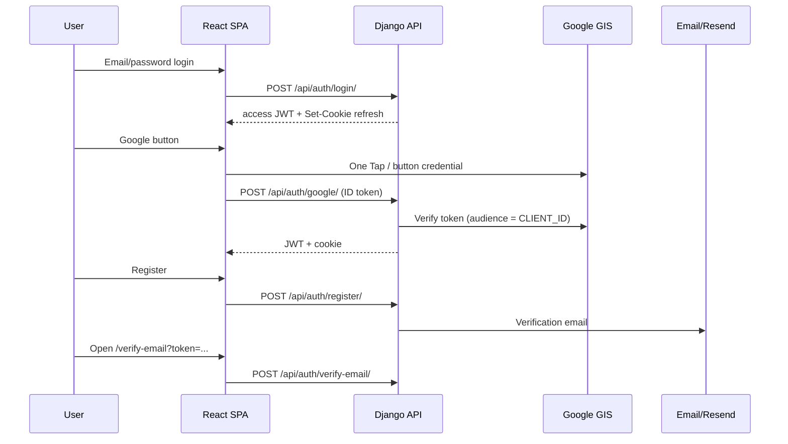
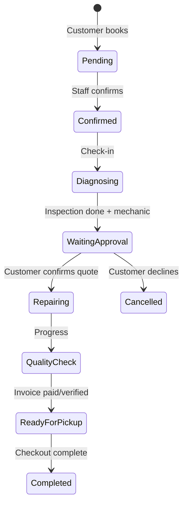

# CarSV — Car Garage Management System  
## Technical Project Report

**Project:** CarSV (Car Garage Management System)  
**Institution context:** AUB Year 4 software application project  
**Repository:** `https://github.com/NamAyheng/carsv-aub.git`  
**Audit branch / HEAD:** `ayheng` @ `bbf3bc5` (2026-10-23)  
**Production (test hosting):** Frontend `https://carsv-web.onrender.com` · API `https://carsv-api.onrender.com`  
**Primary requirements sources:**  
- `prompt/Car Garage Management System.md`  
- `prompt/Assignment - Car Garage Management System - Final - English.md`  

**Report status:** Evidence-based audit of the repository as of the date above. Secrets, passwords, tokens, and private customer records are intentionally omitted.

---

## 1. Executive Summary

CarSV is a full-stack garage service and vehicle repair management system. Customers use a React (Vite) public website and authenticated portal. Garage staff operate primarily through a Django Unfold admin console backed by a rich domain model and REST APIs. The system covers the core visit lifecycle: booking → confirmation → check-in → inspection → customer quote approval → repair stages → invoice/payment → ready for pickup / completed, plus spare-parts inventory, notifications (including Telegram alerts), and catalog content (services, parts, blog).

The project evolved from an early frontend-focused scaffold into a merged Django API + React SPA, then Google/Telegram authentication, then Docker Compose and Render free-tier hosting. Authentication uses **email/password with email verification**, **Google Identity Services (GIS) ID-token verification** (not Auth0 in the current codebase), and **Telegram for account linking / alerts** (login-via-Telegram was added then removed from the customer auth modal).

**Overall compliance:** Major garage workflows are substantially implemented in the backend and customer portal. Gaps remain for multi-role staff REST UIs, formal reporting/KPI charts, maintenance reminder automation, supplier purchasing, password-reset confirmation UI, customer reviews storage, CCTV, and some automated tests that currently fail against tightened workflow gates.

---

## 2. Introduction

This report documents CarSV from original purpose through current hosted state. It is based on:

1. Official assignment / requirements documents under `prompt/`.
2. Source code under `api-backend/` and `web-frontend/`.
3. Deployment docs (`DOCKER.md`, `RENDER.md`, `.env.example`).
4. Git history on branch `ayheng`.
5. Automated tests run during this audit (results reported in §17).

Claims are marked as **verified** (observed in code/config/tests), **documented** (stated in project docs), or **unresolved / needs verification** (requires production access or manual UI smoke tests).

---

## 3. Project Background and Objectives

### 3.1 Problem statement

Traditional garage operations mix paper notes, ad-hoc messaging, and disconnected spreadsheets for customers, vehicles, bookings, repairs, parts, and payments. The assignment asks students to model a coherent garage workflow so Receptionist, Mechanic, Cashier, Manager, Administrator, and Customer roles can participate with correct validation, authorization, and state management.

### 3.2 Objectives (from requirements)

- Implement end-to-end garage workflows from login through checkout and history.
- Practice business logic, data modeling, state management, navigation, validation, authentication, authorization, and UX.
- Support KPI/dashboard thinking, reporting, notifications, and maintenance reminders as part of the operational picture.

### 3.3 Actual product positioning in this repository

| Surface | Role | Technology |
| --- | --- | --- |
| Public marketing site + customer portal | Customer | React SPA (`web-frontend/`) |
| Garage operations console | Admin / staff | Django Unfold admin (`/admin/`) |
| HTTP API | Customer + admin CRUD | Django REST Framework |
| Mobile app | Deferred | `mobile-frontend/` present as future placeholder |

Staff roles (Receptionist, Mechanic, Cashier, Manager) exist as **User.role / Role model values** and admin profiles, but there is **no dedicated React staff application**. Non-admin staff are expected to work through Django admin (with `is_staff`), while the public REST router for garage CRUD defaults to **administrator-only** permission.

---

## 4. Requirements and Scope

### 4.1 In scope (assignment)

Login/logout, profiles, roles, dashboards, customers, vehicles, services/categories, bookings and statuses, check-in, inspection, repair jobs, diagnosis, mechanic management/assignment, repair progress/status, spare parts, stock validation, low stock, estimates/quotations and customer approval, cost calculation, invoices, payments/receipts, checkout, service history, maintenance reminders, notifications, KPI/dashboard, reports, validation, CRUD, testing, documentation, presentation, and live demo.

### 4.2 Out of scope / deferred in this implementation

- Native mobile client (folder reserved).
- Live CCTV / bay camera feeds (UI acknowledges no camera).
- Auth0 as identity provider (requirements text and `update_auth.md` mention Auth0; **code uses Google GIS + local JWT**).
- Persistent free-tier private media on Render.
- Full multi-role staff SPA.

### 4.3 Official requirements authority

Where wording differs between Khmer and English assignment files, expected behavior is taken from both, with English used for terminology in this report. Where implementation diverges from the assignment, §18 records the discrepancy instead of rewriting the requirement.

---

## 5. Technology Stack and Development Environment

### 5.1 Backend (`api-backend/`)

| Item | Choice (verified) |
| --- | --- |
| Language / runtime | Python 3.12 (Docker image) |
| Framework | Django **6.1.1** |
| API | Django REST Framework **3.18.1** |
| Auth tokens | SimpleJWT **5.5.1** (access JWT + refresh cookie) |
| Admin UI | django-unfold **0.107.0** |
| DB drivers | SQLite default; `psycopg` for Postgres |
| Server | Gunicorn + WhiteNoise |
| Google verify | `google-auth` |
| Email (prod) | Custom Resend HTTPS backend (`requests`) |
| Imaging | Pillow |

Single business app: `django_app`. Project package: `django_backend`.

### 5.2 Frontend (`web-frontend/`)

| Item | Choice (verified) |
| --- | --- |
| Bundler | Vite **6** |
| UI | React **19** + TypeScript |
| Routing | react-router-dom **v7** |
| State | React Context (`AppContext`) |
| Styling | Tailwind CSS **v4** |
| Icons | lucide-react |

Declared but largely unused in `src/`: `recharts`, `motion`, `@google/genai`, `express` (AI Studio leftovers).

### 5.3 Local tooling

- Node 22 (frontend Docker image).
- Optional local SQLite without Compose (`README.md` / `prompt/terminal-run.md`).
- Docker Compose: Postgres 17 + API + Vite dev server (`docker-compose.yml`).

### 5.4 Environment configuration (purposes only)

Root `.env.example` documents (among others): `DJANGO_SECRET_KEY`, `DJANGO_DEBUG`, cookie secure/SameSite, allowed hosts, CSRF/CORS origins, Postgres credentials for Compose, `GOOGLE_CLIENT_ID`, Telegram bot settings, `FRONTEND_URL`, email backend / Resend, optional superuser bootstrap, optional `DJANGO_SEED_DEMO`. **No secret values are reproduced in this report.**

---

## 6. System Architecture

### 6.1 Logical architecture

### 6.2 How components collaborate

1. Customer opens the SPA (local `:3000` or Render Static Site).
2. Auth endpoints issue a short-lived **access JWT** (stored in memory on the client) and a longer **refresh token** in HttpOnly cookie `carsv_refresh` (path `/api/auth/`).
3. Customer portal loads aggregated data from `/api/customer/*`.
4. Staff manage visits, stock, and payment verification in Unfold admin; domain rules live mainly in `django_app/models.py`.
5. Public catalog (`/api/public/services/`, `/api/public/blog/`) serves marketing content without login.
6. Media: catalog prefixes are public; private uploads require signed `?m=` URLs (or staff session / DEBUG).

### 6.3 Local Docker architecture

Verified Compose services: `db`, `api`, `web`. Volumes: `carsv_pgdata`, `carsv_web_node_modules`. API bind-mounts `./api-backend` so local media persist on the host.

### 6.4 Production (Render) architecture

Documented in `RENDER.md`. Deploy branch: **`ayheng`**.

---

## 7. Database Design

### 7.1 Technology

| Environment | Database |
| --- | --- |
| Default local (no Compose) | SQLite `db.sqlite3` |
| Docker Compose | PostgreSQL 17 (`carsv` DB, host port **5433**) |
| Render | PostgreSQL via `DATABASE_URL` |

Migrations are managed by Django under `django_app/migrations/`. Entrypoint runs `migrate --noinput` on container start.

### 7.2 Main entities and relationships (simplified ER)

Primary model definitions: `api-backend/django_app/models.py` (approximately 2,600+ lines). Supporting models include `InspectionImage`, `PartRequest`, `TelegramLinkPending`, `BlogPost`.

### 7.3 Important constraints (verified)

- Unique customer email / user email; unique vehicle plate numbers.
- Booking–service extras unique per `(booking, service)`.
- Parts stock decrement on confirmed usage (`PartsUsage` / part-request confirmation paths).
- Repair stage advances gated by mechanic assignment, completed inspection, cleared part requests, and paid invoice where required.
- Invoice costs synced from services + parts (`ensure_visit_invoice` / `sync_invoice_costs` family of helpers).

### 7.4 Seeding

| Command | Purpose |
| --- | --- |
| `seed_catalog_demo` | Idempotent public catalog (services/parts/blog); opt-in via `DJANGO_SEED_DEMO=1` |
| `seed_users` / `populate_garage` | Local demo users and linked sample garage data (not for Render free shell) |

Catalog images are baked from `api-backend/catalog_media/` into the Docker image at build time.

### 7.5 Persistence notes

- Compose Postgres data: named volume `carsv_pgdata`.
- Local private uploads: `api-backend/media/` (gitignored), bind-mounted in Compose.
- Render free disk: **ephemeral** — private uploads can disappear on sleep/redeploy; catalog files in the image survive until rebuild.

---

## 8. Frontend Implementation

### 8.1 Route map (verified in `src/App.tsx`, `src/routes.ts`)

**Public:** `/`, `/about`, `/services`, `/how-it-works`, `/live-bay`, `/contact`, `/blog`, `/verify-email`.

**Customer portal** (requires authenticated user with role `CUSTOMER`): `/dashboard`, `/vehicles`, `/appointments`, `/tracking`, `/quotes`, `/parts`, `/invoices`, `/documents`, `/reviews`, `/profile`.

### 8.2 API client

- `src/api/client.ts` — base URL `VITE_API_URL`, Bearer access token, cookie-based refresh, single retry on 401.
- `src/api/garage.ts` — customer portal loaders and mutations.
- Dev proxy: Vite forwards `/api` and `/media` to `VITE_PROXY_TARGET` (Compose: `http://api:8000`).

### 8.3 What is real vs incomplete in the UI

| Area | Status |
| --- | --- |
| Vehicles, bookings, tracking, quotes, parts requests, invoices/payments (KHQR proof), profile, notifications | Wired to `/api/customer/*` |
| Documents | Client-assembled from invoices/work orders + PDF helper — not a separate document store |
| Reviews / feedback | UI exists; live mode reports reviews are **not stored yet** |
| Live bay / CCTV | Marketing/tracking UI; no camera feed |
| Password reset confirm page | **Missing** — request exists; token confirm UI not present |
| Remember me | Checkbox not wired to persistence |
| Staff/admin React modules | Empty stub folders; unused legacy `CustomerPortal.tsx` |
| Telegram Login Widget helpers | Present in utils/client but **not** used by current auth modal (alerts connect only) |

### 8.4 Styling and UX

Tailwind-based customer chrome, theme toggle, toasts/confirm modals. Profile UI includes some hardcoded chrome (e.g. “2FA Enabled” display) that should not be read as a verified MFA feature.

---

## 9. Backend and API Implementation

### 9.1 URL groups (`django_backend/urls.py`)

| Group | Prefix | Audience |
| --- | --- | --- |
| Auth | `/api/auth/*` | Public + authenticated |
| Telegram webhook | `/api/telegram/webhook/` | Bot |
| Public catalog | `/api/public/*` | Anonymous |
| Staff REST CRUD | `/api/...` ViewSets | **Admin only** (`IsGarageAdmin`) |
| Customer portal | `/api/customer/*` | `IsCustomer` |
| Admin UI | `/admin/` | Staff session |
| Media | `/media/<path>` | Public prefixes or signed |

### 9.2 Staff REST resources

Users, customers, vehicles, service categories/services, bookings, staff, inspections, mechanics, repair jobs, spare-part categories/parts, parts usages, invoices, payments.

**Not** on the staff REST router (handled in admin and/or customer API): `Estimate`, `Notification`, `PartRequest`, `BlogPost`, `Role`, etc.

### 9.3 Customer API highlights

Vehicles CRUD; bookings create/cancel/reschedule/add-service; repairs read + confirm/decline; inspections read; invoices read; payments claim/withdraw; parts catalog; part-requests; history; estimates approve/reject; notifications mark-read.

### 9.4 Business logic location

Most visit workflow enforcement is in `models.py` helpers and Unfold admin actions (file ~5,700 lines), not in thin ViewSets. This means the **authoritative staff UX is admin**, while the customer SPA mirrors status and performs customer-side decisions (quote approve, payment proof).

---

## 10. Authentication and Security

### 10.1 Mechanisms actually implemented

| Mechanism | Status | Evidence |
| --- | --- | --- |
| Email/password register + login | Implemented | `auth_services.password_login`, `auth_api` |
| Email verification before customer login | Implemented | `email_verified` gate for customers |
| Password reset request + confirm API | Implemented (backend) | Frontend missing confirm page |
| Google login via GIS ID token | Implemented | `GOOGLE_CLIENT_ID`, `google-auth` verify |
| Google account linking | Implemented | `/api/auth/link/google/` |
| Telegram Login Widget API | Implemented in backend | Removed from customer login UI (commit `77cc079`) |
| Telegram connect for alerts | Implemented | Profile connect + webhook/poller |
| Auth0 | **Not found in codebase** | No Auth0 SDK/config |
| MFA | **Not implemented** as product feature | Do not treat UI chrome as MFA |
| Access JWT (15 min) + refresh cookie (7 d, rotate + blacklist) | Implemented | SimpleJWT settings |
| CORS | Custom middleware allowlist | Not django-cors-headers |
| Media ACL | Public catalog vs signed private | `media_serving.py` |

### 10.2 Authentication flows

### 10.3 Google-only accounts vs email/password (Case documented in `update_auth.md`)

**Historical problem (documented + addressed in git):** Google login succeeded, but email/password with the same address was rejected because the Google-created user had **no usable local password**.

**Verified fix direction (commit `44cac72` — “Fix Google-only accounts for email/password login on Render”):**  
`password_login` checks `has_usable_password()`; Google-only users are guided through **password reset / set-password** rather than silent account takeover by email string match. Automated coverage includes `test_google_only_account_password_login_and_reset` in `django_app/tests.py`.

**Production verification status:** Code and unit tests support the fix. Whether every existing Render account has been successfully password-linked remains a **manual smoke-test** item (see §21).

### 10.4 Email registration delivery

- Local default: console email backend.
- Render: Resend HTTPS API (SMTP blocked on free web services).
- Free Resend sender often only delivers to allowlisted test addresses (documented in `prompt/All-Users.md`).
- Commit `bbf3bc5` treats form registration as success when verification **email send fails**, so the user record can exist while delivery fails — important for sandbox limits, but teachers should understand accounts may remain unverified until email works.

### 10.5 Roles and authorization

User roles: `ADMIN`, `MANAGER`, `RECEPTIONIST`, `MECHANIC`, `CASHIER`, `CUSTOMER`.  
API reality:

- Customer portal → `IsCustomer`.
- Staff ViewSets → `IsGarageAdmin` (admin/superuser).
- Role flags sync Customer/Staff/Mechanic profile rows via `apply_role_assignment`.

Fine-grained “permission matrix editor” as a first-class product UI is **not** a separate SPA feature; Django admin permissions + role codes are the practical control plane.

---

## 11. Core Business Workflows

### 11.1 Visit / repair workflow (implemented)

Aligned with assignment statuses (Waiting → Diagnosing → Waiting for Approval → Repairing → Quality Check → Ready for Pickup → Completed), with booking status kept in sync from the work order where implemented.

### 11.2 Feature notes by domain

| Workflow | Implementation notes |
| --- | --- |
| Booking | Customer API create/reschedule/cancel; conflict rules focus on vehicle open visits more than bay calendars |
| Check-in | `check_in_booking` — creates/advances job, inspection, invoice |
| Inspection | Mileage, fuel, condition, damage, photos; completion required before quote stage |
| Diagnosis | Captured primarily as inspection + job problem fields (no separate Diagnosis table) |
| Mechanic assignment | Mechanic model + job FK; workload analytics limited |
| Parts | Stock validation + deduction; customer `PartRequest` pipeline |
| Estimate | Visit quote gate via repair confirm **and** separate `Estimate` model (approve/reject does not fully drive the same stage machine) |
| Cost / invoice | Labor/service/parts/discount/tax fields; formulas match assignment conceptually |
| Payment | Customer pending claim + proof for non-cash; staff verify/reject in admin |
| Checkout | Ready-for-pickup gated on payment; completion updates history |
| Notifications | In-app `Notification` rows; Telegram alerts when linked |
| Maintenance reminder | Vehicle next-service fields exist; automated due monitoring/notify is limited |
| KPI / reports | Admin/customer dashboards summarize counts; full exportable report module not a first-class verified feature |

---

## 12. Local Development and Docker

### 12.1 Recommended Compose workflow (verified against `docker-compose.yml` / `DOCKER.md`)

1. Copy `.env.example` → `.env` and set non-secret local values.
2. `docker compose up --build`
3. Open frontend `http://localhost:3000`, API/admin `http://localhost:8000/admin/`.
4. Stop with `docker compose down` (add `-v` only if intentionally wiping Postgres volume).

### 12.2 Manual (non-Docker) path

Documented in `README.md` / `prompt/terminal-run.md`: Python venv + `runserver`, Node `npm run dev`, typically SQLite. This path remains valid for light backend work.

### 12.3 Entrypoint behavior (`api-backend/docker-entrypoint.sh`)

Wait for Postgres (if configured) → migrate → collectstatic → optional superuser → optional catalog seed → optional Telegram webhook registration → exec Gunicorn/CMD.

### 12.4 Difference: Compose vs production static frontend

- Compose `web` runs **Vite dev server** (`npm run dev`).
- Render Static Site runs **`npm ci && npm run build`** and publishes `dist` with SPA rewrite `/* → /index.html`.

---

## 13. Git History and Development Timeline

Remote: `origin` → `https://github.com/NamAyheng/carsv-aub.git`.  
Active work: branch **`ayheng`** (ahead of `main` @ `cb85f30`).

| Period | Commits (examples) | Phase |
| --- | --- | --- |
| 2026-08-22 | `1f9cda7` … `ff6be66` | Repository init / early Django scaffold |
| 2026-09-10 | `cb85f30` | Admin/Customer frontend era (`main` tip) |
| 2026-09-18 … 09-26 | `2fa89ab`, `4287f68` | Real `api-backend` models, admin, media/inventory |
| 2026-10-13 | `8a16d6e`, `d4f1db7` | Merge frontend ↔ backend API / auth |
| 2026-10-18 | `290fed6` | Google & Telegram integrations |
| 2026-10-23 | `60626f8` … `bbf3bc5` | Render/Docker docs, catalog/email fixes, Google password linking, Telegram webhook hardening, phone prompt, register-on-email-fail |

Other remote branches observed: `origin/rith`, `origin/ro` (older history tip `ff6be66`).

**Evidence limit:** Motivations are inferred only from commit messages, code, and docs. No private chat logs were used.

---

## 14. Deployment to Render

### 14.1 Services (documented + config-backed)

1. **PostgreSQL (Free)** — `DATABASE_URL`.
2. **Web Service (Docker)** — root `api-backend`, Dockerfile entrypoint, Gunicorn on `$PORT`.
3. **Static Site** — root `web-frontend`, build to `dist`, env `VITE_API_URL`.

### 14.2 Critical production settings (by purpose)

- Secure cookies + `SameSite=None` for cross-site refresh cookie.
- CORS/CSRF/`FRONTEND_URL` must match the Static Site origin.
- Resend backend + API key for verification/reset mail.
- Optional one-time `DJANGO_SUPERUSER_*` and `DJANGO_SEED_DEMO=1`, then remove/disable.
- Google authorized JavaScript origins must include the Static Site URL (and local origins for dev).

### 14.3 Free-tier limitations (documented)

- API sleep after ~15 minutes idle (~1 minute cold start).
- Free Postgres ~30-day lifetime; no backups.
- Ephemeral disk → private uploads not durable.
- SMTP blocked → Resend HTTPS required.
- No free shell → prefer env bootstrap over interactive `populate_garage`.

### 14.4 Smoke-test checklist (from `RENDER.md`, not executed in this audit)

Register → Resend verify → login → browse services/parts → book → payment proof (expect ephemeral private media).

---

## 15. Problems Encountered and Solutions

Evidence-based log (chronological / thematic). Status reflects repository evidence at HEAD.

| # | Problem | Symptoms | Root cause (if verified) | Solution / evidence | Status |
| --- | --- | --- | --- | --- | --- |
| 1 | Split frontend/backend eras | Early UI without durable API | Project grew in stages | Merge commits `8a16d6e` / `d4f1db7` | Resolved historically |
| 2 | Local Postgres port clash | Conflict with other Postgres on 5432 | Host port collision | Compose binds `127.0.0.1:5433` | Resolved |
| 3 | Media hidden by empty named volume | Images missing in containers | Volume over mount | Bind-mount whole `api-backend` (compose comments) | Resolved |
| 4 | Render catalog images missing | Public images 404 after deploy | Ephemeral FS / media not in image | Bake `catalog_media` in Dockerfile; seed command (`1622980`) | Resolved in code |
| 5 | Resend / email casing | Delivery/lookup issues | Email normalization | Lowercase handling (`1622980`) | Resolved in code |
| 6 | Google-only vs password login | Password login rejected for Google email | No usable password on OAuth user | Set-password / reset path (`44cac72` + tests) | Code fixed; prod accounts need manual verify |
| 7 | Telegram login UX vs alerts product | Confusion / webhook errors | Dual use of Telegram | Removed Telegram from login modal; alerts-only (`77cc079`); webhook hardening (`ffc10d7`, `e6a569c`) | Mostly resolved |
| 8 | Missing phone blocks Telegram alerts | Alerts cannot match customer | Phone optional after Google | Post-login phone prompt (`6cb84fb`) | Resolved in code |
| 9 | Verification email fails on free Resend | User thinks register broken | Provider sandbox limits | Register succeeds even if send fails (`bbf3bc5`); still requires verify before login | Partial / operational |
| 10 | Customer API tests vs stricter gates | 7 failing tests at audit time | Tests lag workflow rules (inspection/mechanic gates) | Needs test update or workflow revisit | **Open** |
| 11 | Auth0 wording vs implementation | Docs say Auth0 | Product uses Google GIS | Clarify docs/teaching materials | Documentation mismatch |
| 12 | Password reset UX incomplete | User cannot enter token in SPA | Missing confirm route | Backend APIs exist | **Open** (frontend) |

---

## 16. Testing and Results

### 16.1 What exists

- Backend suite: `api-backend/django_app/tests.py` (~2,189 lines).
  - `TelegramPhoneMatchTests`
  - `ApiAuthTests`
  - `CustomerApiTests`
  - `AdminDashboardSecurityTests`
- Frontend: TypeScript check via `npm run lint` (`tsc --noEmit`); **no Jest/Vitest suite found**.
- CI: **No** `.github/workflows` found.
- Production smoke tests: checklist only in `RENDER.md` (not executed here).

### 16.2 Tests run during this audit

| Suite | Result | Notes |
| --- | --- | --- |
| `ApiAuthTests` + `AdminDashboardSecurityTests` | **33 passed** | Auth, Google/Telegram unit paths, media, CORS, seed, Resend backend mocking |
| `CustomerApiTests` | **7 failed / 31 run** | Failures related to inspection completion, mechanic assignment before inspection, privacy/upload/part-request expectations |
| `TelegramPhoneMatchTests` | Included with customer run batch | Combined batch reported failures from CustomerApiTests |

**Failing `CustomerApiTests` names (audit run):**

1. `test_confirming_a_part_request_opens_a_work_order_when_the_car_has_none`  
2. `test_confirming_a_part_request_uses_the_open_job_and_invoice`  
3. `test_customer_invoice_and_estimate_stay_private`  
4. `test_next_stage_updates_the_work_order_and_the_booking`  
5. `test_profile_photo_upload_returns_a_media_url`  
6. `test_quote_confirm_and_cancel_follow_the_same_booking`  
7. `test_work_order_form_copies_the_visit_and_rejects_a_second_job`  

Example assertion messages observed: inspection not finished; assign technician before starting inspection.

### 16.3 Coverage gaps

- No automated E2E browser tests for the assignment live-demo path.
- Staff role permission matrix not exhaustively tested via REST.
- Frontend production build was **not** re-run in this audit session (recommended before submission).
- Render smoke checklist not executed by the auditor.

---

## 17. Requirements Compliance Matrix

Statuses used: **Implemented and verified** · **Implemented but not fully verified** · **Partially implemented** · **Not implemented** · **Unable to verify**.

| Requirement | Expected behavior | Actual implementation | Evidence | Status | Remaining work |
| --- | --- | --- | --- | --- | --- |
| 1. Login & Logout | Email/username + password; clear session | JWT + refresh cookie; SPA logout | `auth_api.py`, `CustomerAuthModal` | Implemented and verified (unit) | Prod smoke; password UX polish |
| 2. User Profile | View/edit name, email, phone, photo | Customer profile + `/api/auth/me/` | `CustomerProfileView`, auth me endpoint | Implemented and verified | Staff profile UX is admin-centric |
| 3. Role & Permission | Admin manages roles; enforce permissions | Role model + User.role; API mostly Admin vs Customer | `models.Role`, `permissions.py` | Partially implemented | No full permission matrix UI; staff REST not multi-role |
| 4. Dashboard | KPI cards for garage ops | Customer dashboard aggregates portal data; admin lists | `CustomerDashboardHome`, Unfold | Partially implemented | Manager KPI charts/export limited |
| 5. Customer Management | Staff CRUD customers | Admin + admin REST; customers self-register | admin, ViewSets | Implemented but not fully verified | No React receptionist UI |
| 6. Customer Profile | Vehicles, bookings, repairs, history | Portal tabs + history API | customer API, portal views | Implemented and verified | — |
| 7. Vehicle Management | CRUD + unique plate | Customer vehicles API + admin | models/serializers/UI | Implemented and verified | — |
| 8. Vehicle Detail | Owner, mileage, history | Portal vehicle + tracking/history | UI + API | Implemented and verified | — |
| 9. Vehicle Service History | Completed jobs, parts, cost, next service | History endpoint + vehicle fields | `/api/customer/history/` | Partially implemented | Next-maintenance automation weak |
| 10. Service Category | Admin manage categories | Models + admin + seed | `ServiceCategory` | Implemented and verified | — |
| 11. Service Management | Catalog with price/duration | Models + public/customer APIs | `Service`, public services | Implemented and verified | — |
| 12. Service Booking | Create booking with conflict checks | Customer booking create | customer bookings API | Implemented and verified | Bay/mechanic calendar conflicts limited |
| 13. Booking Status | Pending→…→Completed/Cancelled | Enum + sync from job | `Booking` statuses | Implemented and verified | Legacy CHECKED_IN/IN_SERVICE still present |
| 14. Booking Search & Filter | Staff search tools | Admin filters; customer list filters in UI | Unfold admin, appointments UI | Partially implemented | Full staff search UX not in React |
| 15. Vehicle Check-in | Record arrival, mileage, status | `check_in_booking` + admin | models/admin | Implemented and verified | Walk-in UX mainly admin |
| 16. Initial Inspection | Condition, damage, photos | `Inspection` + images | models/admin/customer read | Implemented and verified | — |
| 17. Repair Job / Work Order | Create WO, assign mechanic | `RepairJob` OneToOne booking | models/admin | Implemented and verified | — |
| 18. Diagnosis Management | Root cause, recommended repair | Via inspection/job fields | models | Partially implemented | No separate diagnosis entity/UI product |
| 19. Mechanic Management | Skills, availability | `Mechanic` model + admin | models | Implemented but not fully verified | Workload metrics limited |
| 20. Mechanic Assignment | Assign + history/notify | Job.mechanic FK + notifications | models | Partially implemented | Limited assignment history model |
| 21. Repair Status | Full stage machine + validation | Gated advances | models helpers | Implemented and verified | Keep tests aligned with gates |
| 22. Repair Progress | % / timeline | Progress derived from status; tracking UI | RepairJob.progress, Tracking | Implemented and verified | — |
| 23. Spare Parts Management | Stock CRUD | Models + admin + customer catalog | `SparePart` | Implemented and verified | — |
| 24. Parts Usage | Deduct stock, cost | `PartsUsage` + part requests | models | Implemented and verified | Some related tests failing |
| 25. Stock Validation | Block oversell | Validation in usage/confirm | models/tests | Implemented but not fully verified | Re-run failing tests after fix |
| 26. Low Stock Detection | Alert when ≤ minimum | Model flags / admin awareness | `min_stock`, quantity | Partially implemented | Dedicated alert/report UX limited |
| 27. Estimate / Quotation | Cost breakdown document | Visit quote + `Estimate` model | models, Quotes UI | Partially implemented | Dual quotation tracks not fully unified |
| 28. Customer Approval | Approve/reject before repair | `/repairs/{id}/confirm|decline/` | customer_api, Quotes | Implemented and verified | — |
| 29. Cost Calculation | Subtotal/Grand Total formulas | Invoice fields + sync | `Invoice` | Implemented and verified | Labor often manual/zero |
| 30. Invoice Management | Generate after repair path | Auto visit invoice | models | Implemented and verified | Line-item invoice rows limited |
| 31. Payment Management | Methods + balance updates | Claims + verify | `Payment`, invoices UI | Implemented and verified | CARD/BANK forms partly display-only in SPA |
| 32. Payment Receipt | Receipt number/print | Client documents/PDF | Documents view | Partially implemented | Formal receipt module limited |
| 33. Vehicle Checkout | Payment verify then release | Ready-for-pickup gate | stage machine | Implemented and verified | — |
| 34. Service History | Persist completed work | History API | customer history | Implemented and verified | — |
| 35. Maintenance Reminder | Due date/mileage notify | Next service fields | Vehicle fields | Partially implemented | Monitoring/notify automation incomplete |
| 36. Notification Management | Event messages + read state | `Notification` + Telegram | models, portal | Implemented and verified | Rule engine is code-driven |
| 37. KPI & Dashboard | Revenue, averages, return rate | Basic aggregates | dashboards | Partially implemented | Advanced KPI formulas incomplete |
| 38. Reports | Filtered exports PDF/Excel | Not a full reports module | — | Not implemented | Build reports or scope down assignment demo |
| 39. Validation & Error Handling | Required, duplicate, stock, workflow | Serializers + model gates | widespread | Implemented and verified | Continue hardening edge cases |
| 40. State Management | Cross-module consistency | DB as source of truth; SPA reload | portal loaders | Implemented and verified | Large AppContext still holds unused staff stubs |
| 41. CRUD | Standard CRUD everywhere needed | Admin + customer APIs | ViewSets/admin | Implemented and verified | Staff CRUD UX = admin |
| 42–43. Functional / E2E testing | Systematic test of full path | Backend unit/API tests; no E2E | tests.py | Partially implemented | Fix 7 failures; add E2E |
| 44–46. Documentation / Presentation / Demo | Docs + live demo | This report + RENDER/DOCKER/README | prompt/, docs | Partially implemented | Presentation slides not in repo; demo depends on Render uptime |

---

## 18. Limitations and Remaining Issues

1. **Staff experience** is Unfold-admin-centric; assignment roles beyond Admin/Customer lack dedicated apps.  
2. **Auth0** is not the live identity stack despite some document wording — Google GIS is.  
3. **Password reset confirmation UI** missing in SPA.  
4. **Reviews, CCTV, suppliers, purchase orders, PDF/Excel reports** incomplete or absent.  
5. **Render free tier** weakens demos (cold start, ephemeral uploads, DB expiry, Resend sandbox).  
6. **CustomerApiTests** currently failing (7) — risk for academic “testing” scoring until updated.  
7. **Estimate vs visit-quote** dualism can confuse demos if both are shown without explanation.  
8. **Mobile frontend** not delivered.  
9. Credentials appearing in local note files must never be committed or pasted into submissions beyond private instructor channels.

---

## 19. Conclusion and Recommendations

CarSV successfully demonstrates a realistic garage visit lifecycle with a production-shaped split between a customer SPA and a Django operational backend, including modern auth (email verify, Google, Telegram alerts), inventory-aware parts usage, payment proof verification, Dockerized local development, and Render deployment documentation.

To strengthen academic submission and production readiness:

1. Fix or update the seven failing customer API tests to match the gated workflow.  
2. Add a password-reset confirm page in the SPA.  
3. Align all docs to say **Google GIS**, not Auth0, unless Auth0 is actually integrated.  
4. Prepare a scripted live demo that uses Admin for staff steps and the portal for customer steps.  
5. Decide scope for Reports/KPI/Maintenance Reminder: implement thin versions or explicitly mark as future work in the presentation.  
6. Before teacher demo on Render: warm the API, verify Resend inbox, confirm Google origins, and expect private upload ephemerality.

---

## 20. References

1. `prompt/Car Garage Management System.md` — primary detailed requirements.  
2. `prompt/Assignment - Car Garage Management System - Final - English.md` — English assignment text.  
3. `README.md`, `DOCKER.md`, `RENDER.md`, `.env.example`.  
4. `api-backend/django_app/models.py`, `auth_services.py`, `auth_api.py`, `customer_api.py`, `admin.py`, `tests.py`.  
5. `web-frontend/src/App.tsx`, `src/api/*`, `src/components/customer/*`.  
6. Git history on `ayheng` through `bbf3bc5`.  
7. `update_auth.md` — authentication investigation brief (Auth0 wording vs GIS reality noted).  
8. `prompt/All-Users.md` — operational test notes (URLs/config; secrets omitted here).

---

## 21. Appendices

### Appendix A — Repository areas inspected

- `api-backend/` (settings, models, auth, customer API, admin, media, Docker entrypoint, tests, requirements)
- `web-frontend/` (routes, auth modal, portal views, API client, Vite/Docker)
- `docker-compose.yml`, `DOCKER.md`, `RENDER.md`, `.env.example`
- `prompt/` requirements and notes
- Git remotes, branches, and commit timeline
- Automated Django test execution (subset + customer suite)

### Appendix B — Evidence limitations

- Production HTTP smoke tests against Render were **not** executed in this audit.  
- No inspection of live database rows or private uploads.  
- Frontend production build and full `npm` lint were not re-run in this session.  
- Unfold admin action surface is large; not every admin button path was manually clicked.  
- `mobile-frontend/` not deeply audited beyond placeholder status.

### Appendix C — Questions for the project owner

1. Should teaching materials standardize on **Google GIS** and remove Auth0 wording?  
2. For the live demo, will staff steps be shown only in `/admin/`, or is a React staff UI still planned?  
3. Which Resend sender/domain will the evaluator use (sandbox vs verified domain)?  
4. Should failing `CustomerApiTests` be fixed before submission, or is a known-issue note acceptable?  
5. Is password-reset confirm UI required for the grading checklist?

### Appendix D — Claims still needing verification before teacher submission

- [ ] End-to-end Render smoke: register → verify email → login → book → admin check-in → quote approve → pay → complete.  
- [ ] Google + later password login on a fresh account.  
- [ ] Telegram alert delivery after phone share on Render (DB separate from local).  
- [ ] Private payment proof survives only until sleep/redeploy (demonstrate limitation honestly).  
- [ ] Re-run full `manage.py test` after any test fixes — target zero failures.  
- [ ] `npm run build` for `web-frontend` succeeds with production `VITE_API_URL`.  
- [ ] Confirm no secrets in git-tracked files for the submission branch.

---

*End of report.*
